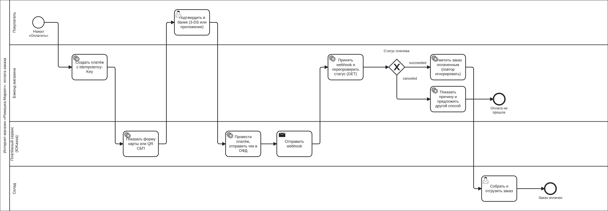
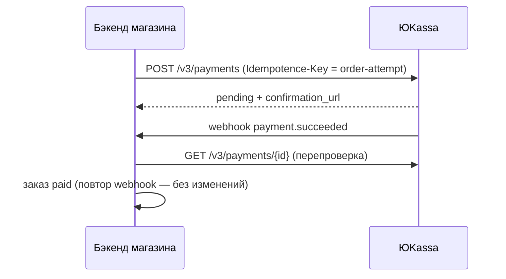
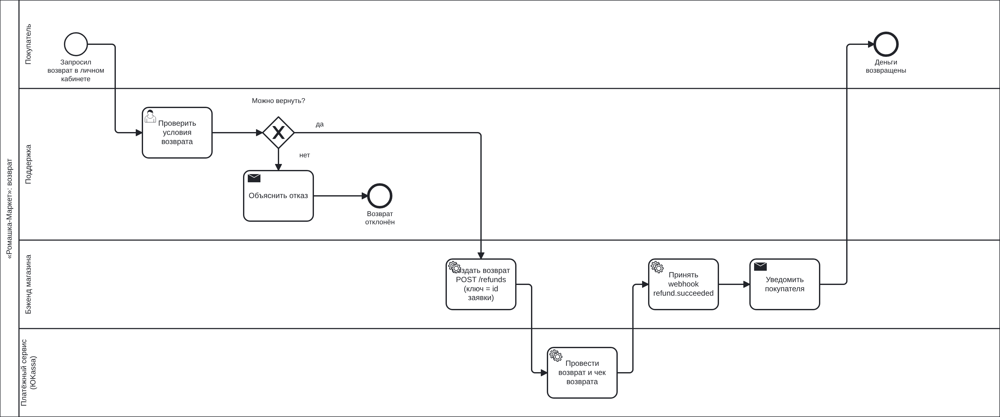

# Оплата в интернет-магазине: карта, QR СБП, цифровой рубль и возвраты

> **Учебный проект.** Интернет-магазин «Ромашка-Маркет» вымышленный, данные синтетические, внедрения не было.
> Платёжный сервис — публичный API ЮKassa (тестовый магазин). СБП и цифровой рубль в тестовом режиме недоступны, поэтому описаны как **учебная модель**, а не как живые вызовы. Роль: бизнес-/системный аналитик.

**За 30 секунд.** Магазин теряет мобильных покупателей на оплате (конверсия 80 % против 88 % на десктопе), списывает деньги дважды у 0,6 % заказов, а возврат ждут по 2–4 дня. По данным я нашёл причины: треть отказов — 3-DS, двойные списания — повторный клик без ключа идемпотентности, задержка статуса — опрос раз в 30 минут вместо webhooks. Спроектировал TO-BE: идемпотентное создание платежа, webhook + страховочный опрос, возврат по кнопке через API, СБП первым способом на мобильном и подготовку к цифровому рублю. Описал API бэкенда, sequence, статусы, тест-кейсы на тестовые карты.

**Главные артефакты:** [Sequence и статусы](docs/03_integration.md) · [OpenAPI](api/openapi.yaml) · [Требования и тест-кейсы](docs/02_requirements.md) · [СБП и цифровой рубль](docs/04_sbp_digital_ruble.md)

## Навигация
| Раздел | Где |
|---|---|
| Контекст, данные AS-IS, гипотезы, стейкхолдеры | [docs/01_context.md](docs/01_context.md) |
| Процессы оплаты и возврата (BPMN) | [bpmn/](bpmn/) |
| Истории, правила, НФТ, KPI, тест-кейсы | [docs/02_requirements.md](docs/02_requirements.md) |
| Интеграция: sequence, статусы, ключи идемпотентности | [docs/03_integration.md](docs/03_integration.md) |
| СБП и цифровой рубль | [docs/04_sbp_digital_ruble.md](docs/04_sbp_digital_ruble.md) |
| API бэкенда магазина | [api/openapi.yaml](api/openapi.yaml) |
| Коллекция Postman для тестового магазина | [api/yookassa-test.postman_collection.json](api/yookassa-test.postman_collection.json) |
| Данные и SQL | [data/](data/), [sql/](sql/) |
| Решения | [decisions/](decisions/) |
| Бэклог | [backlog/jira-backlog.csv](backlog/jira-backlog.csv) |
| Гайд защиты | [DEFENSE.md](DEFENSE.md) |

## Что показали данные (сентябрь–октябрь 2026, 4 000 заказов)
| Вопрос | Ответ | Запрос |
|---|---|---|
| Конверсия оплаты | 82,8 % (mobile 80,2 %, desktop 88,0 %) | [01](sql/01_conversion.sql) |
| Почему отказы | 3-DS — 31,8 %, не подтвердил вовремя — 20,5 %, нет денег — 20,5 %; ~55 % уходят после отказа | [02](sql/02_decline_reasons.sql) |
| Двойные списания | 20 заказов (0,6 %), 69 470 ₽, повтор через 3 с | [03](sql/03_double_charges.sql) |
| Задержка статуса | 15 мин в среднем, p95 29 мин; 244 повторных webhook | [04](sql/04_status_lag_and_webhooks.sql) |
| Возвраты | медиана 48 ч ожидания оператора, у провайдера ~0,5 ч | [05](sql/05_refund_time.sql) |

## TO-BE: оплата



Полная версия с ошибками и таймаутами — [docs/03_integration.md](docs/03_integration.md).

## TO-BE: возврат


## Цели
| KPI | Было | Цель |
|---|---|---|
| Конверсия оплаты mobile | 80,2 % | 86 % (гипотеза, проверить A/B) |
| Двойные списания | 0,60 % | 0 |
| Задержка статуса, p95 | 28,7 мин | ≤ 1 мин |
| Медиана возврата | ~48 ч | ≤ 4 ч |

## Ключевые решения
- [ADR-001](decisions/ADR-001-webhook-plus-safety-poll.md) — webhook + перепроверка `GET` + страховочный опрос через 10 минут.
- [ADR-002](decisions/ADR-002-warehouse-notification-rest-vs-queue.md) — склад узнаёт об оплате через очередь, а не синхронным вызовом.
- [ADR-003](decisions/ADR-003-one-stage-payments.md) — одностадийная оплата.

## Edge cases
Двойной клик, повторный webhook, потерянный webhook, таймаут провайдера, частичный возврат больше остатка, покупатель не вернулся из приложения банка после СБП, мошенничество (`fraud_suspected` — не раскрываем причину).

## Что проверено, а что нет
| | Статус |
|---|---|
| SQL на синтетических данных | запущено в PostgreSQL 16, цифры выше — результат |
| OpenAPI | валидирован (openapi-spec-validator) |
| Коллекция Postman против тестового магазина ЮKassa | собрана по документации, **живым запросом не проверена** |
| СБП, цифровой рубль | **учебная модель**; сроки и комиссии — по открытым источникам, проверить у Банка России и НСПК |

## Что сделал бы иначе
Начал бы с A/B-теста «СБП первым на мобильном» на 2 недели до полной разработки: гипотеза о росте конверсии — главный риск кейса.

## Как сделано
Черновик собран как учебный проект вместе с ИИ-ассистентом (Claude): генерация синтетических данных, ревью требований. Что я переделал и проверил сам — в [DEFENSE.md](DEFENSE.md), §8.

### Как запустить
```bash
createdb payments
psql -d payments -f data/ddl.sql
python data/generate_data.py && psql -d payments -f data/seed.sql
psql -d payments -f sql/01_conversion.sql
```
Postman: импортировать коллекцию, заполнить `shopId` и `secretKey` тестового магазина ЮKassa.

---
## English summary
Learning project (fictional online store, synthetic data). Mobile payment conversion is 80% vs 88% on desktop, 0.6% of orders were charged twice and refunds took 2–4 days. SQL analysis traced the causes to 3-DS failures, missing idempotency keys on payment creation and 30-minute status polling. The TO-BE design adds idempotent payment creation, webhooks with verification and a safety poll, API-based refunds, SBP QR payments first on mobile, and readiness for the digital ruble. Artifacts: BPMN, sequence and state diagrams, OpenAPI for the store backend, a Postman collection for the YooKassa test shop (not live-tested), user stories, test cases, KPIs and ADRs.
