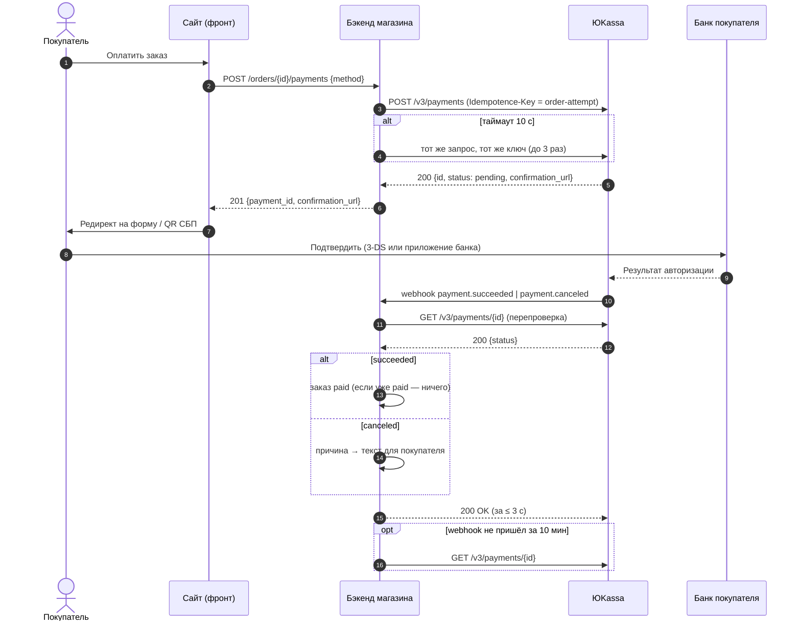
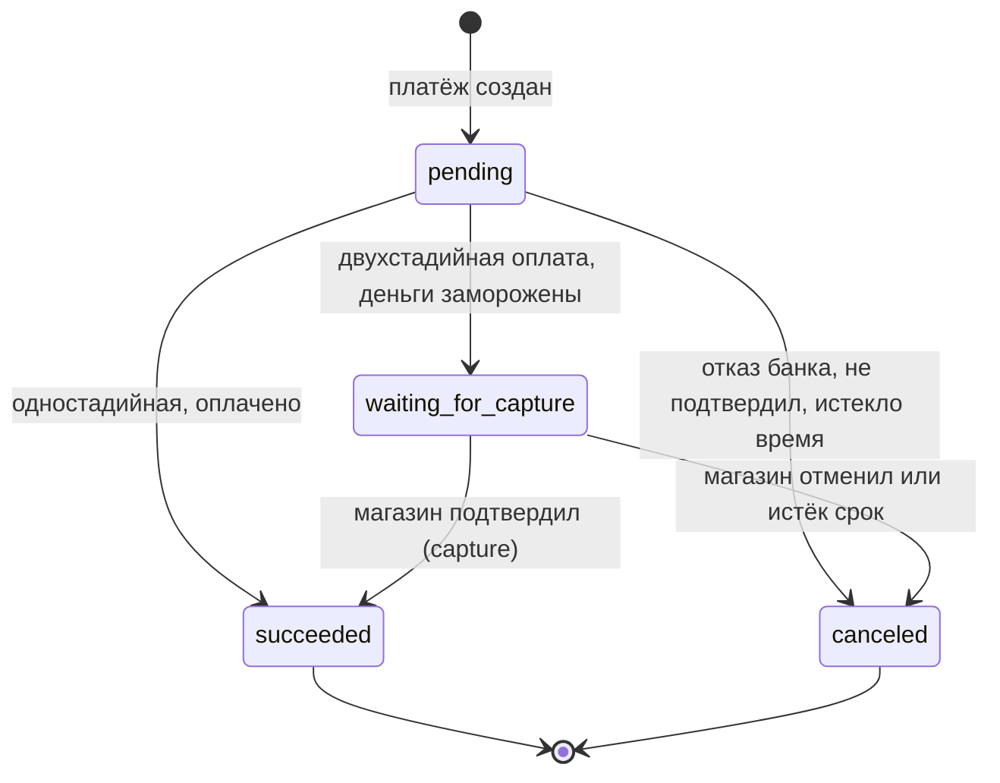
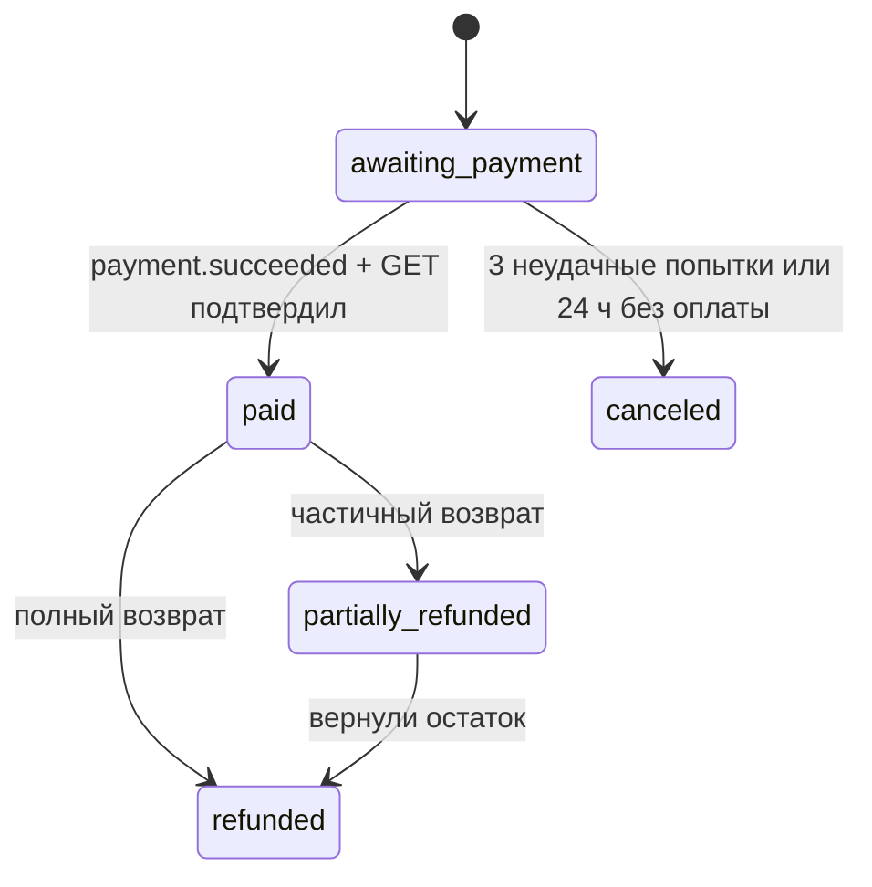

# 3. Интеграция с платёжным сервисом

## 3.1. Последовательность: оплата картой или СБП

Исходник PlantUML: `uml/payment-sequence.puml`.

## 3.2. Статусы платежа (модель платёжного сервиса)

Магазин использует **одностадийную** оплату (`capture: true`): товары в наличии, резервировать деньги не нужно. Двухстадийная пригодилась бы для товаров под заказ — отмечено как открытый вопрос.

## 3.3. Статусы заказа в магазине

## 3.4. Ключи идемпотентности
| Операция | Ключ | Почему так |
|---|---|---|
| Создание платежа | `{order_id}-{attempt_no}` | повтор той же попытки → тот же платёж; новая попытка только после `canceled` |
| Создание возврата | `refund-{refund_request_id}` | оператор нажал кнопку дважды → один возврат |
| Обработка webhook | `payment_id + event` | повторная доставка не меняет заказ |

> Деталь, которую спрашивают: у ЮKassa заголовок называется `Idempotence-Key`, во многих других API — `Idempotency-Key`. В нашем API магазина используется `Idempotency-Key` (`api/openapi.yaml`).

## 3.5. Что можно проверить руками
`api/yookassa-test.postman_collection.json` — коллекция для тестового магазина ЮKassa (создать платёж, получить статус, вернуть). Нужны `shopId` и секретный ключ тестового магазина (регистрация бесплатна, договор не нужен).
**Статус проверки:** коллекция собрана по документации, живым запросом из этого окружения не проверялась.
